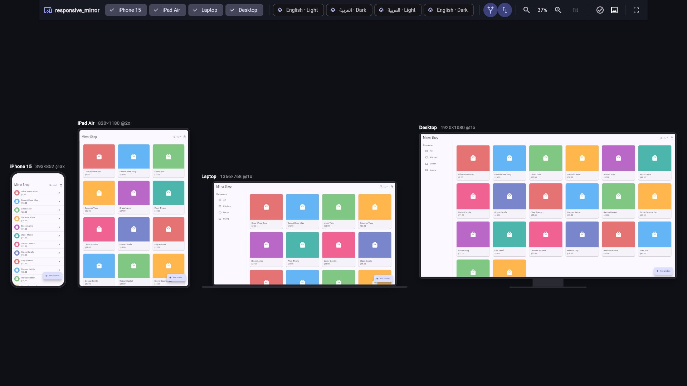
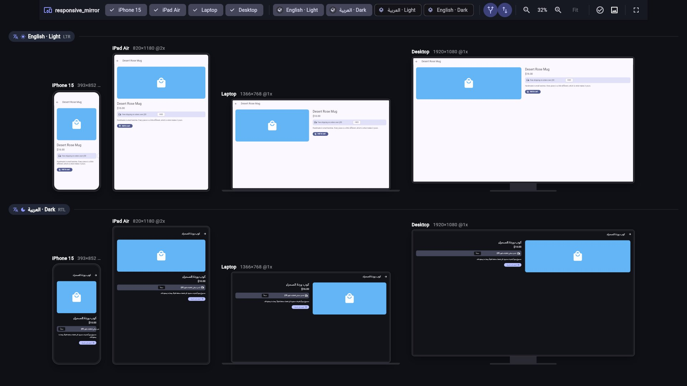
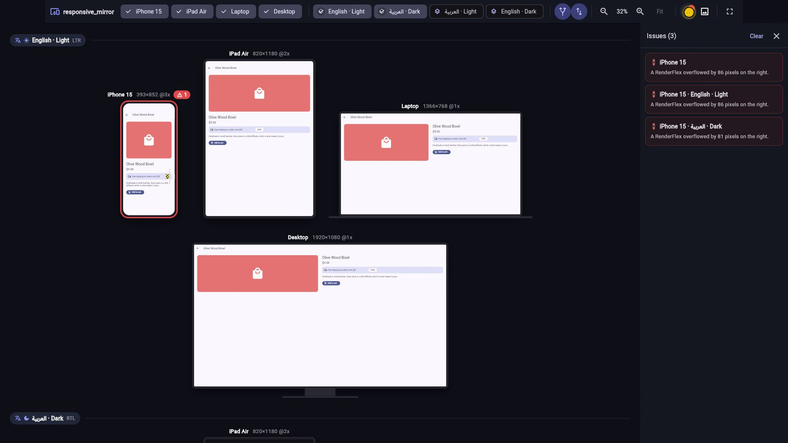
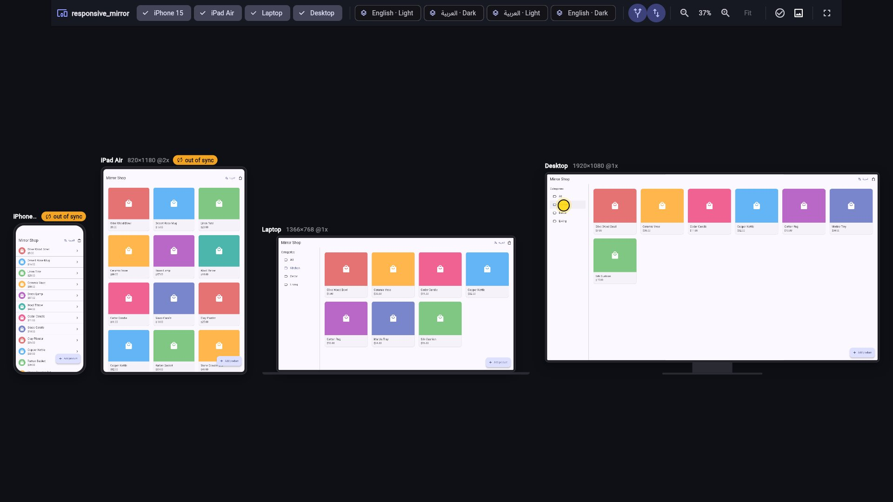

# responsive_mirror

[](LICENSE)


See your Flutter app on a **phone, a tablet, a laptop and a desktop at the same
time**. Open a page or scroll on one device and every device follows. Put
Arabic (RTL) next to English, dark next to light. Find the device where your
layout overflows, and export everything as PNG.

```dart
void main() => runApp(ResponsiveMirror(child: MyApp()));
```

It is a plain widget, so it runs wherever Flutter runs: **Windows, Linux,
macOS and the web** (Chrome). In release builds it steps aside and returns your
app unchanged (`enabled` defaults to `kDebugMode`).



## Features

| | |
|---|---|
| Device grid | iPhone, iPad, 1366×768 laptop and 1920×1080 desktop by default, plus presets and custom sizes. Each device gets its own `MediaQuery` (size, pixel ratio, safe areas, text scale, platform) and its own `Navigator`. Zoom, pan, Fit, show/hide devices from the toolbar. |
| Navigation sync | A `NavigatorObserver` on every device; a push / pop / replace on one is replayed on the others. |
| Scroll sync | Scrolling one device moves the matching scrollable on the others to the same **fraction** (0..1), so a short phone list and a wide desktop grid stay at the same place. |
| Variants (v0.2) | The same screen in several locales and themes as a matrix (devices × variants): `en·light`, `ar·dark`, … RTL is applied automatically. |
| Overflow report (v0.3) | Every `FlutterError` (RenderFlex overflow, build/layout exceptions) is traced to the device and variant it came from: red outline, badge with a count, an issues panel, and `controller.issues` for CI. |
| PNG export (v0.3) | Each device at its real resolution (iPhone 15 = 1179×2556) or the whole grid as one sheet. Saved to a folder on desktop, downloaded on the web. |
| Isolated mode (v0.4, web) | Every device is a **separate instance** of your web build with its own state. Taps, typing and scrolling are replayed on the others, matched by key / label / text, with an "out of sync" badge when a device has no matching widget. |

## Quick start

```yaml
dev_dependencies:
  responsive_mirror:
    git: https://github.com/AbdAlftahSalem/responsive_mirror
```

Wrap your app and add one line to your `MaterialApp`:

```dart
import 'package:responsive_mirror/responsive_mirror.dart';

void main() => runApp(const ResponsiveMirror(child: MyApp()));

class MyApp extends StatelessWidget {
  const MyApp({super.key});

  @override
  Widget build(BuildContext context) {
    return MaterialApp(
      // Lets the mirror replay push/pop on every device.
      // Outside a mirror it returns an inert observer, so it can stay.
      navigatorObservers: [ResponsiveMirror.navigatorObserverOf(context)],
      home: const HomePage(),
    );
  }
}
```

Run it on Windows / Linux / macOS (`flutter run -d windows`) or in Chrome
(`flutter run -d chrome`).

### Languages and themes side by side



```dart
ResponsiveMirror(
  variants: MirrorVariant.matrix(
    [MirrorVariant.english, MirrorVariant.arabic],
    [MirrorVariant.light, MirrorVariant.dark],
  ),
  child: const MyApp(),
)
```

Let the variant win over your app's own choice:

```dart
MaterialApp(
  locale: ResponsiveMirror.localeOf(context) ?? myLocale,
  themeMode: ResponsiveMirror.themeModeOf(context) ?? ThemeMode.system,
  // ...
)
```

Theme variants also set `MediaQuery.platformBrightness`, so apps that use
`ThemeMode.system` switch with no code change.

### Overflow report and PNG export



Nothing to configure: open the screen, and any device where a `RenderFlex`
overflows (or anything throws) turns red. In tests or CI:

```dart
final controller = ResponsiveMirrorController();
// ... pump ResponsiveMirror(controller: controller, child: MyApp())
expect(controller.issues, isEmpty);

final pngs = await controller.exportPng(perDevice: true);
```

### Isolated mode (web)



```dart
ResponsiveMirror(mode: MirrorMode.isolated, child: const MyApp())
```

Each device loads the same page in an iframe (`?rm_frame=…`). Inside the
frame, `ResponsiveMirror` notices it and runs your app with a small
`ResponsiveMirrorAgent` instead of the grid. The agent reports taps, text and
scrolling to the host over `postMessage`; the host relays them to the other
devices, which replay them on the matching widget:

1. the nearest `ValueKey`,
2. else the semantics label / tooltip / input label,
3. else the visible text,
4. then the position among identical candidates.

Coordinates are never used, because every device has its own layout. If a
device has nothing that matches (a desktop-only side panel, for example), it
gets an amber **out of sync** badge with the reason, and the next action that
matches clears it. Give important buttons a `ValueKey` or a tooltip and the
replay becomes exact.

## API

| | |
|---|---|
| `ResponsiveMirror(child:, builder:)` | Mirrors `child`, or `builder(context, slot)` when you need the device (e.g. `slot.platform`). |
| `devices` | `MirrorDevices.defaults` (iPhone 15, iPad Air, Laptop 1366×768, Desktop 1920×1080). Also `iPhoneSE`, `pixel8`, `laptop1440`, `MirrorDevices.all`, and `MirrorDevice.custom(name:, size:, devicePixelRatio:, safeArea:, platform:)`. |
| `variants` | `MirrorVariant.english`, `.arabic`, `.light`, `.dark`, `.largeText`, `MirrorVariant.locale(Locale)`, `MirrorVariant.theme(ThemeMode)`, `a.combine(b)`, `MirrorVariant.matrix(locales, themes)`. |
| `enabled` | Default `kDebugMode`. When false the app is returned as is. |
| `syncNavigation`, `syncScroll`, `zoom`, `showToolbar`, `backgroundColor` | Initial state (also on the toolbar). |
| `onExport` | Receive the exported PNGs yourself instead of the default save / download. |
| `mode` | `MirrorMode.inProcess` (default, every platform) or `MirrorMode.isolated` (web). |
| `ResponsiveMirrorController` | `devices`, `setVisible`, `variants`, `setVariantVisible`, `zoom`, `zoomIn()`, `zoomOut()`, `fit()`, `syncNavigation`, `syncScroll`, `issues`, `clearIssues()`, `showIssues`, `exportPng(perDevice:)`, `mirrorVisible`. |
| `ResponsiveMirror.navigatorObserverOf(context)` | The observer to add to `MaterialApp.navigatorObservers`. |
| `ResponsiveMirror.slotOf / localeOf / themeModeOf / isMirrored(context)` | What the current device and variant ask for. |

## How it works

**In-process mode** (default). Every device builds its own copy of your app
widget inside one Flutter app, under its own `MediaQuery`, `Directionality`
and `Navigator`. State that lives *above* your `MaterialApp` (a store, a
provider, a `ValueNotifier`) is shared, so a tap that changes state updates
every device at once and taps are **not** replayed. Only navigation (each
device's `NavigatorObserver` → the same route replayed on the others, guarded
against feedback loops) and scrolling (scroll notifications → the same
fraction on the matching scrollable) are synced.

**Isolated mode** (web). Separate instances, separate state, input replayed by
target matching, as described above.

## Comparison

Both packages below are good at what they do; this is to help you pick.

| | responsive_mirror | [device_preview](https://pub.dev/packages/device_preview) | [multi_device_preview](https://pub.dev/packages/multi_device_preview) |
|---|---|---|---|
| Several devices at once | Yes | No, one device at a time | Yes |
| Runs on | Windows, Linux, macOS, web | All platforms | macOS (debug) |
| Laptop / desktop sizes | Yes (1366, 1440, 1920, custom) | Presets, one at a time | Phones and tablets |
| State per device | Shared (in-process) or separate (isolated, web) | n/a | Separate |
| How devices stay in sync | Route replay + scroll fraction; replayed taps in isolated mode | n/a | Replayed taps, scroll and text |
| RTL vs LTR, dark vs light side by side | Yes | — | Text scale side by side |
| Overflow report per device | Yes | — | — |
| Export PNGs | Each device or the whole grid | — | Store screenshots |
| Maturity | New | Mature, widely used | New |

Read from each package's README in November 2026; "—" means not listed
there. multi_device_preview's tap mirroring between real separate instances is
excellent on macOS, and device_preview is the reference for single-device
simulation; responsive_mirror's angle is every desktop OS and the web, desktop
breakpoints, locale/theme matrices and the overflow report.

## Limitations

* Overflow detection works in **debug** builds only: Flutter reports
  `RenderFlex` overflows from debug assertions.
* In-process mode shares state above `MaterialApp`; if you need truly
  independent instances use isolated mode (web).
* Apps that keep **one global navigator key** (GetX's `GetMaterialApp` uses
  `Get.key`) cannot run several copies in one process: only one device
  renders. Use isolated mode (web) for them; every frame is its own instance.
* In isolated mode the frames share the page's origin, so they share
  `localStorage` / IndexedDB (tokens, caches). Signing in on all devices at
  the same moment can race; sign in once with input sync off (or reload after
  signing in) and every instance starts signed in.
* In isolated mode a tap is matched by key, then label, then text. Across
  languages the text differs, so give tap targets a `ValueKey` if you mirror
  an Arabic row next to an English one.
* Every isolated frame is a full Flutter web engine with its own WebGL
  context, and Chrome keeps only about 16 per page: keep isolated mode to
  about 6–8 devices (e.g. 3 devices × 2 variants).
* Isolated mode is **web only**. Separate instances of a Flutter desktop app
  need separate engines or windows, which a widget inside one app cannot embed
  today; the web has iframes. On other platforms it falls back to in-process
  mode with a debug message.
* In isolated mode, a tap is replayed only when the target can be identified
  (key, label or text). Icon-only buttons without a tooltip are skipped.
  Gestures other than taps (drag, long press) are not replayed yet.
* Scroll sync matches scrollables by axis, order and nearest `ValueKey`; very
  different layouts per device may not have a matching list.

## Example

`example/` is a small shop: a product list / grid, a product page, an
"Add product" form, an Arabic / English toggle, a desktop-only category panel
and one deliberately overflowing promo strip.

```bash
cd example
flutter run -d chrome                      # in-process
# then open ?variants=1 or ?mode=isolated
```

## License

MIT © Abd Alftah Salem
